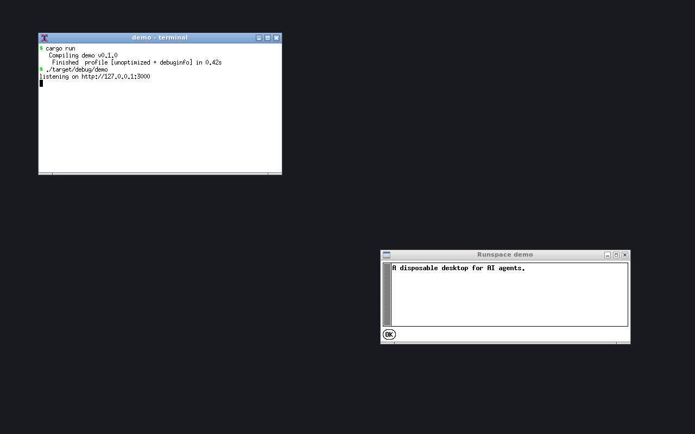

# Runspace

[](https://github.com/h4nxxlmao/runspace/actions/workflows/ci.yml)
[](LICENSE)
[](#platform-support)

**Disposable virtual desktops for AI agents. Linux and Windows, natively.**

[Documentation](https://getsingularity.lol/runspace) · [Install](#install) · [MCP tools](#mcp-tools) · [Contributing](CONTRIBUTING.md)

Runspace gives an agent a real graphical workspace it can launch, watch, click, type into, screenshot, and destroy. It is not a virtual machine and not a container: each runspace is a lightweight desktop plus a window manager, tagged so it can be cleaned up completely.

```text
                          ┌──────────────────────────────┐
agent ── stdio (MCP) ───▶ │ runspace mcp <id>            │
                          └──────────────┬───────────────┘
                                         │
                 ┌───────────────────────┴───────────────────────┐
                 ▼                                               ▼
      Linux: Xvfb / Xephyr                            Windows: hidden Win32 desktop
      xdotool + openbox + x11rb                       CreateDesktop + PrintWindow + jobs
```



Windows screenshots: [invisible desktop](docs/windows-desktop.png) and
[the live viewer](docs/windows-visible.png).

## Why

Agents are good at writing GUI applications and bad at checking whether they actually work. Runspace closes that loop without handing the agent your desktop:

- **Isolated by construction.** Mouse and keyboard events are injected into a private desktop, never the host.
- **Fast.** A runspace is a desktop, not an OS. Warm create is ~130 ms on Windows and ~350–400 ms on Linux.
- **No images.** No rootfs, no VM image, no Docker pull, no WSL distro. One small binary uses the desktop APIs already present on the machine.
- **Disposable.** `destroy` kills every process in the runspace, removes its desktop/sockets/logs/state, and leaves no per-runspace disk footprint.
- **One interface everywhere.** The CLI, state model and 29 MCP tools are identical on Linux and Windows.

## Platform support

| Platform | Backend | Status |
| --- | --- | --- |
| Linux X11 | Xvfb (invisible) / Xephyr (visible) | v0.1, complete |
| Windows 10/11 x64 | Native hidden Win32 desktop | v0.1, complete |
| Linux Wayland | Xvfb, plus XWayland for visible mode | works today |
| macOS / Windows ARM64 | — | planned |

## Requirements

### Linux

| Dependency | Required | Used for |
| --- | --- | --- |
| `Xvfb` | yes | invisible desktops |
| `xdotool` | yes | mouse, keyboard, window control |
| `openbox` | recommended | focus, move/resize, decorations |
| `Xephyr` | for `--visible` | nested window on your desktop |
| `xrandr` | for resizing | live resolution changes |

Debian / Ubuntu:

```sh
sudo apt-get install -y xvfb xserver-xephyr xdotool openbox x11-xserver-utils
```

Arch:

```sh
sudo pacman -S xorg-server-xvfb xorg-server-xephyr xdotool openbox xorg-xrandr
```

Fedora:

```sh
sudo dnf install -y xorg-x11-server-Xvfb xorg-x11-server-Xephyr xdotool openbox xrandr
```

Run `runspace doctor` to check what is available. It exits non-zero when a required tool is missing.

### Windows

Windows 10 or 11, x64. **No WSL, no extra downloads, no guest OS.** Runspace uses `CreateDesktop`, job objects, `PrintWindow` and posted window messages, all built into Windows. `runspace doctor` verifies the three native capabilities it needs.

## Install

### Linux

```sh
curl -fsSL https://raw.githubusercontent.com/h4nxxlmao/runspace/main/install.sh | sh
```

The script installs a prebuilt release when one is available and falls back to `cargo install`. Override the repository with `RUNSPACE_REPO=owner/repo` or the target directory with `RUNSPACE_INSTALL_DIR=/usr/local/bin`.

### Windows

```powershell
irm https://raw.githubusercontent.com/h4nxxlmao/runspace/main/install.ps1 | iex
```

The installer downloads the latest `runspace-x86_64-pc-windows-msvc.exe` into `%LOCALAPPDATA%\Runspace\bin`, adds that directory to your user `PATH`, and runs `runspace doctor`. Override the repository with `$env:RUNSPACE_REPO`, pin a release with `$env:RUNSPACE_VERSION`, or choose a directory with `$env:RUNSPACE_INSTALL_DIR`.

Windows may show a SmartScreen prompt for a newly published unsigned binary. Choose "More info" → "Run anyway", or build from source.

### From source (both)

```sh
cargo install --git https://github.com/h4nxxlmao/runspace.git --locked
```

On Windows this needs the MSVC Rust toolchain. The built binary is self-contained.

## Quick start

```sh
runspace doctor
runspace create --name demo
runspace list
runspace mcp demo
```

`runspace mcp <id|name>` speaks MCP over stdio. Add it to your agent's MCP configuration:

```json
{
  "mcpServers": {
    "runspace": {
      "command": "runspace",
      "args": ["mcp", "demo"]
    }
  }
}
```

If exactly one runspace is active, you can omit the target (`runspace mcp`).

A typical agent loop:

1. `screenshot` to see the desktop.
2. `launch_app` with the application under test, optionally with `wait_for_window`.
3. `get_ui_tree` for a text view, or `wait_for_idle` and `screenshot` for a visual view.
4. `click`, `type`, `key`, `drag`, `scroll`, `list_windows`, `focus_window`.
5. `get_logs` when an app fails to start.
6. `destroy` when done.

Watch it live:

```sh
runspace create --visible --name demo
runspace attach demo
```

On Windows, `attach` also promotes an invisible runspace by opening a viewer on demand. The viewer is a live, view-only mirror; input still goes through MCP.

Auto-destroy an abandoned runspace:

```sh
runspace create --name demo --idle-timeout 900
```

Idle means no MCP activity. Every tool call refreshes the activity marker. The watchdog is a tiny detached process and exits when the runspace is destroyed.

## CLI

```text
runspace create [--visible] [--record] [-r WxH] [-n NAME] [--idle-timeout SECONDS] [--json]
runspace list [--json]                    alias: ls
runspace info <id|name> [--json]
runspace attach <id|name>
runspace logs <id|name> [-f] [-n LINES]
runspace trace <id|name> [--html FILE]
runspace inspect <id|name> [--json]
runspace launch <id|name> "COMMAND" [--cwd DIR] [--wait-for TEXT] [--wait-class CLASS] [--timeout-ms MS] [--json]
runspace screenshot <id|name> [--out FILE] [--window WINDOW] [--json]
runspace windows <id|name> [--json]
runspace find <id|name> [--text TEXT] [--class CLASS] [--window WINDOW] [--json]
runspace click-control <id|name> [--text TEXT] [--class CLASS] [--window WINDOW] [--button BUTTON] [--count N] [--json]
runspace type-control <id|name> --input TEXT [--text TEXT] [--class CLASS] [--window WINDOW] [--clear] [--submit] [--json]
runspace destroy <id|name>... [--json]    alias: rm
runspace destroy --all
runspace mcp [id|name]
runspace doctor [--json]
```

Targets can be a full id, a unique id prefix (3+ characters), or a name. `list` reports id, name, mode, display, resolution, uptime, backend pid and live memory. On Windows the display column is `win32`; on Linux it is `:N`. `launch` takes a shell command string, so quote the whole command when it contains spaces.

Create options:

| Flag | Default | Meaning |
| --- | --- | --- |
| `--visible` | off | Show a live viewer window (Xephyr on Linux, a native viewer on Windows) |
| `--resolution`, `-r` | `1280x800` | Desktop size (`320x240` to `7680x4320`) |
| `--name`, `-n` | none | Human-friendly target name |
| `--idle-timeout` | none | Auto-destroy after N seconds without MCP activity |
| `--record` | off | Record tool calls and screenshots for `runspace trace` |
| `--json` | off | Machine-readable output |

## MCP tools

### Desktop

| Tool | Description |
| --- | --- |
| `screenshot` | Full desktop as a PNG image block |
| `mouse_move(x, y)` | Absolute cursor position |
| `click(button?, x?, y?, count?)` | Left/middle/right click |
| `double_click(x?, y?)` | Double click |
| `right_click(x?, y?)` | Right click |
| `drag(from_x, from_y, to_x, to_y, button?, duration_ms?)` | Press, move, release |
| `scroll(direction, amount?, x?, y?)` | Wheel up/down/left/right |
| `type(text)` | Type into the focused window |
| `key(keys)` | One or more combinations: `"ctrl+s"`, `["ctrl+c", "ctrl+v"]` |
| `get_cursor_position` | Cursor coordinates |
| `wait(ms)` | Sleep |
| `wait_for_idle(timeout_ms?, quiet_ms?)` | Wait until the screen stops changing |

### Windows and applications

| Tool | Description |
| --- | --- |
| `launch_app(command, cwd?, wait_ms?, wait_for_window?, wait_for_window_class?, wait_timeout_ms?)` | Launch a command inside the runspace; optionally wait for its window |
| `wait_for_window(title?, class?, timeout_ms?)` | Wait for a matching visible window and return it as JSON |
| `list_windows` | JSON array of visible windows |
| `screenshot_window(id_or_title)` | Capture one visible window as a PNG image |
| `get_ui_tree` | Text hierarchy of windows and native controls for non-vision agents |
| `focus_window(id_or_title)` | Activate and raise |
| `close_window(id_or_title, force?)` | Graceful close, optional kill |
| `move_window(id_or_title, x, y)` | Move |
| `resize_window(id_or_title, width, height)` | Resize |

### UI queries

| Tool | Description |
| --- | --- |
| `find_ui(text?, class?, window?, limit?)` | Find windows and native controls; returns absolute click coordinates |
| `wait_for_ui(text?, class?, window?, limit?, timeout_ms?)` | Wait for a matching window or control and return it as JSON |
| `click_ui(text?, class?, window?, limit?, button?, count?)` | Click the center of the first enabled match |
| `type_ui(input, text?, class?, window?, limit?, clear?, submit?)` | Click a match and type into it |

### Runspace

| Tool | Description |
| --- | --- |
| `get_info` | JSON metadata, uptime, pids, memory, recording state, log path, backend/desktop/job |
| `set_resolution(width, height)` | Resize the logical canvas |
| `get_logs(lines?)` | Tail the backend/application log |
| `destroy` | Kill everything and remove the runspace |


## Non-vision agents

Agents that cannot read screenshots do not need them:

- `get_ui_tree` returns a JSON hierarchy of visible windows and native controls: class, text, bounds, enabled and focused. On Windows this includes Button/Edit/Static text; Linux exposes top-level windows.
- `find_ui` and `wait_for_ui` locate controls by text or class. `click_ui` clicks the center of the first enabled match, and `type_ui` can click and type in one call.
- `wait_for_window` removes startup races. `launch_app` can wait directly with `wait_for_window` or `wait_for_window_class`.
- `get_logs` returns application output. Tool failures automatically include the recent log, the UI tree and a screenshot.
- The CLI equivalents are `runspace find`, `runspace click-control`, `runspace type-control`, and `runspace inspect`; add `--json` for machine-readable output.

## Session traces

Create a runspace with `--record` to capture every MCP tool call and a before-action screenshot:

```sh
runspace create --record --name demo
# ... run the agent ...
runspace trace demo --html demo-trace.html
```

The HTML is self-contained (embedded PNGs), dark-themed, and includes timestamps, arguments, screenshots, a log tail, and runtime stats. Trace data lives inside the runspace and is removed by `destroy`; export before destroying.

## Failure context

When an MCP tool fails, the error response includes the recent log, the current UI tree, and a screenshot. This gives vision agents immediate visual context and non-vision agents enough structure to recover without extra round trips.

## How it works

### Linux backend

- **Invisible mode** starts `Xvfb` on a free display (90–199) with a 24-bit screen.
- **Visible mode** starts `Xephyr` on the host display with `-no-host-grab`, so it never captures your keyboard or mouse.
- `openbox` runs inside the nested display. `create` waits for it to announce itself before returning, so apps launched immediately afterwards are managed correctly.
- Input and window operations are `xdotool` calls with `DISPLAY=:N` only.
- Screenshots are captured in-process with `x11rb` (`GetImage`) and encoded to PNG; scrot and ImageMagick are not required.
- Every process receives `RUNSPACE_ID`. Destroy sweeps `/proc` for that tag, so apps that daemonise are still reaped. The recorded X server PID is verified before it is signalled.
- State lives under `$XDG_RUNTIME_DIR/runspace` (RAM-backed on most systems), falling back to `/dev/shm/runspace-$UID` and then `/tmp/runspace-$UID`.

### Windows backend

- `create` starts a small **keeper** process. The keeper calls `CreateDesktop("Runspace-<id>")` and holds the desktop open together with a named **job object** configured with `JOB_OBJECT_LIMIT_KILL_ON_JOB_CLOSE`.
- Apps are launched on that desktop through a generated `cmd` batch file. Every process is assigned to the job, so children and daemonised processes are killed together.
- Screenshots enumerate the visible windows on the hidden desktop, capture each one with `PrintWindow`, and composite them onto a dark 1024×768 (or requested) canvas. No screen scraping and no host desktop involvement.
- Input is posted to the target window/control: `WM_CHAR` for typing, mouse messages for clicks/drags/wheel, and keyboard messages for keys. Hit-testing uses window rectangles, because `ScreenToClient` is unreliable across desktops. Common shortcuts (`Ctrl+A/C/X/V/Z`, `Alt+F4`) are mapped to the standard control messages.
- `--visible` starts a separate viewer process on your desktop that mirrors the hidden desktop at 5 fps. `attach` starts one on demand, including for invisible runspaces. Closing the viewer does not destroy the runspace.
- Long-lived helpers run from a versioned copy in `%TEMP%\runspace\bin`, so background helpers never lock the installed binary. Stop any connected MCP client before replacing the installed exe. The copy is shared by all runspaces and is removed by `destroy --all`.
- State lives under `%TEMP%\runspace`. Each runspace gets private `home`/`tmp` directories, and launched apps get `USERPROFILE`, `TEMP`, `APPDATA` and `LOCALAPPDATA` pointing into them.

There are no images to download and no daemon. Linux leaves only a zero-byte lock file after `destroy`; Windows also caches the versioned helper (about 2.4 MB) until `destroy --all` or a new build replaces it.

## Performance

Measured release builds. Linux on Ubuntu 26.04 in WSL2; Windows 11 native.

| Metric | Linux X11 | Windows |
| --- | --- | --- |
| Warm create, 1280×800 | 354–397 ms | 127–150 ms |
| First create | 826 ms | 567 ms (one-time helper copy) |
| Destroy | ~40–100 ms (part of 50-cycle avg) | 32–39 ms |
| Create + destroy average | 482 ms | ~170 ms |
| Release binary | 2.7 MB | 2.28 MB |
| Bare invisible runspace RSS | ~80 MiB (Xvfb dominates) | ~6.4–7.0 MiB |
| Screenshot | ~20–50 ms | 73–149 ms |
| After destroy | 0 bytes, 0 processes, 0 X sockets | 0 bytes per runspace; 2.4 MB shared helper cache |

Windows screenshots are slower because each top-level window is captured with `PrintWindow` and composited. A hidden Windows desktop with no app is nearly free; the memory grows with the apps you launch, as it should.

## Isolation

Runspace is designed so an agent's desktop actions cannot reach the host:

- Every Linux input call sets `DISPLAY=:N`; every Windows input call posts to a window on the hidden desktop. There is no fallback to the host desktop.
- Linux gives each runspace its own X server and therefore a private clipboard by default. Windows currently shares the session clipboard across desktops; a separate window station for a private clipboard is planned.
- Multiple runspaces get distinct desktops/display numbers and process jobs; destroying one never touches another.
- The Windows viewer is view-only; it does not forward your mouse or keyboard into the sandbox.

**Scope:** Runspace isolates the desktop and input, not the filesystem or network. Apps launched inside a runspace run as your user and can read the same files and network. Treat it as a GUI testing sandbox, not a security boundary.

## Windows fidelity

Windows does not offer a second interactive display for free, so the native backend is a **Win32-fidelity tier**, not a full virtual display:

- Classic Win32/GDI windows (Notepad, WinForms, Tk, Qt, custom apps) capture and drive well.
- DirectX, some UWP/Store apps and some Chromium surfaces may render black in `PrintWindow`; they may still accept input.
- Typing via `WM_CHAR` is reliable for standard controls. Arbitrary modifier combinations that query global key state may not be honored; the common editing and close shortcuts are handled explicitly.
- The hidden desktop keeps the host display mode; `--resolution` sets the capture canvas, not the Windows display resolution. Apps may see the host screen size, and coordinates outside the canvas are clipped.
- Some cross-toolkit apps (for example Tkinter) create themed child windows that ignore synthetic mouse and keyboard messages without real activation. Capture works, but input may not. Native Win32/GDI controls are the reliable tier.
- The system cursor is not drawn into screenshots. `get_cursor_position` returns the simulated cursor maintained by Runspace.
- `set_resolution` changes the compositor canvas, not the Windows display mode; windows keep their screen coordinates and are clipped to the canvas.
- DPI is handled by marking the process DPI-aware; screenshots are in physical pixels.

A future virtual-display driver or separate Windows session can raise fidelity without changing the CLI or MCP surface.

## Linux limitations

- `attach` focuses an existing visible Xephyr window. Xvfb cannot be promoted live.
- `set_resolution` works on invisible runspaces and cannot exceed the size chosen at creation. Visible Xephyr runspaces keep their creation size.
- Snapshots, network isolation, preinstalled app profiles and the web dashboard are not in v0.1.
- Typing uses `xdotool type`; most UTF-8 text works, but exotic glyphs depend on the X keyboard map.

## Project layout

The crate is organised so the shared lifecycle is separate from the two platform backends:

```text
src/
  core/              paths, state, errors, types, UI, PNG encoding
  platform/
    linux/           Xvfb/Xephyr, xdotool, openbox, x11rb capture, Linux lifecycle
    windows/         Win32 desktops, keeper, job objects, PrintWindow, viewer, Windows lifecycle
  cli.rs             clap surface
  commands.rs        CLI presentation
  ops.rs             platform-neutral lifecycle, UI queries, launch and screenshots
  mcp.rs             the 29-tool stdio server
trace.rs           opt-in recording and self-contained HTML export
  watch.rs           idle/liveness watchdog
  main.rs
tests/
  mcp_e2e.rs         platform-neutral MCP lifecycle test
  windows_e2e.rs     native Win32 GUI round trip
```

`src/platform/mod.rs` is the single facade the rest of the crate talks to. Adding a backend means implementing that surface and re-exporting it behind `cfg`.

## Development

```sh
cargo fmt --check
cargo clippy --all-targets -- -D warnings
cargo test --all-targets
```

Linux end-to-end (needs the X11 tools):

```sh
RUNSPACE_E2E=1 cargo test --test mcp_e2e -- --nocapture
```

Windows end-to-end (no external tools):

```powershell
cargo test --test windows_e2e -- --nocapture
```

The Windows test launches the internal Win32 test app on a hidden desktop, waits for its window, checks the UI tree, screenshots it, clicks the Edit control, types, presses Ctrl+A, replaces the text, verifies the Edit text through the UI tree, clicks the button, exports an HTML trace, closes the window, destroys the runspace, and checks that no state remains.

CI runs fmt, clippy and tests on Ubuntu and Windows. The website is maintained separately and is not part of this repository.

## Contributing

Contributions are welcome. Read [CONTRIBUTING.md](CONTRIBUTING.md) for development setup, test commands, and the pull request checklist. By participating, you agree to the [Code of Conduct](CODE_OF_CONDUCT.md).

## Security

Please report vulnerabilities privately as described in [SECURITY.md](SECURITY.md). Do not open a public issue for a security-sensitive report.

## License

Runspace is free software: you can redistribute it and/or modify it under the terms of the GNU General Public License as published by the Free Software Foundation, either version 3 of the License, or (at your option) any later version.

Runspace is distributed in the hope that it will be useful, but WITHOUT ANY WARRANTY; without even the implied warranty of MERCHANTABILITY or FITNESS FOR A PARTICULAR PURPOSE. See the GNU General Public License for more details.

You should have received a copy of the GNU General Public License along with Runspace. If not, see <https://www.gnu.org/licenses/>.

Copyright (C) 2026 Runspace contributors. See [LICENSE](LICENSE).
